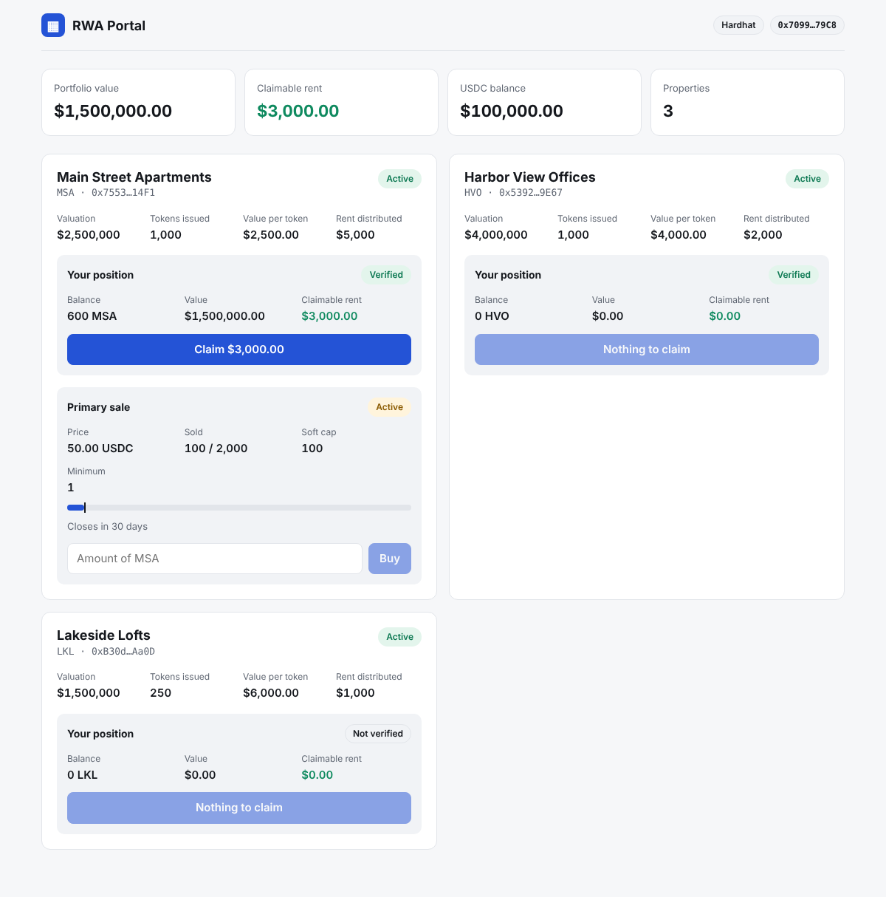
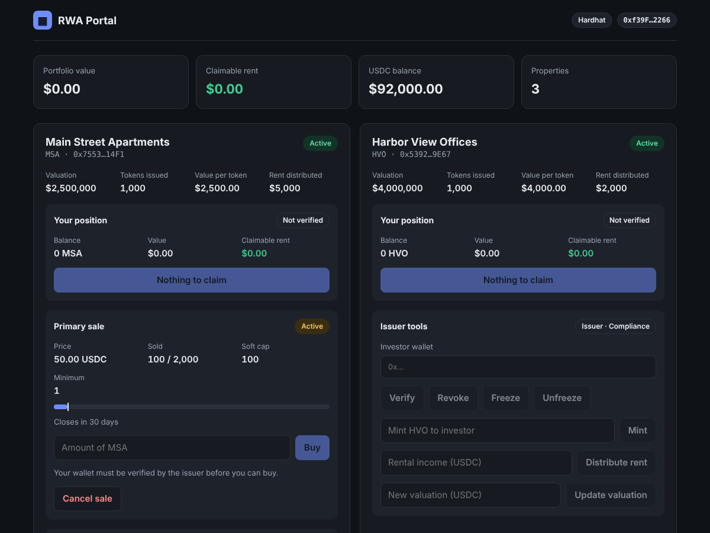
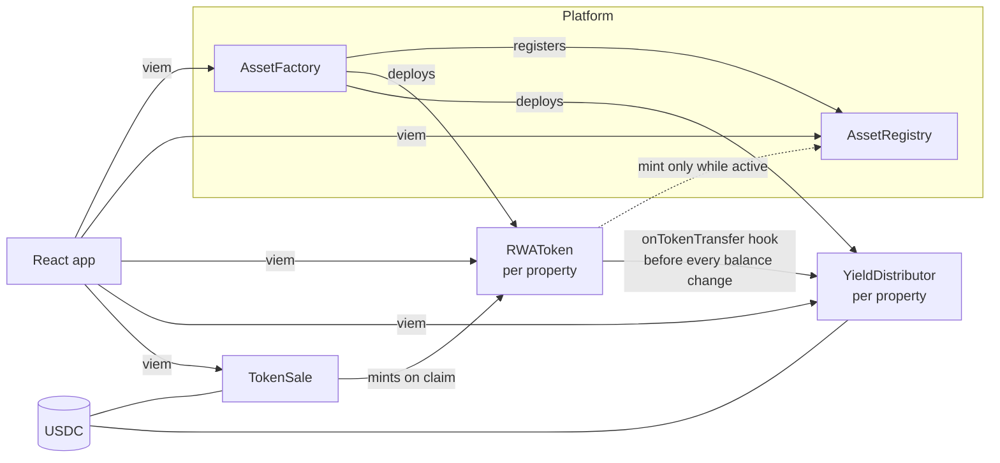

# RWA Portal — Real-World Asset Tokenization

[](https://github.com/crumbs1505/rwa-project/actions/workflows/ci.yml)

A full-stack platform for tokenizing rental properties. Each property becomes
a compliant ERC-20 token. Verified investors buy shares in an escrowed primary
sale and collect their share of the rent in USDC. Issuers launch new
properties, manage investor eligibility, and step in when a court order or a
lost wallet requires it.

Built with Solidity 0.8.24, OpenZeppelin 5, Hardhat 3, React and viem.

| Investor view | Issuer view (dark mode) |
| --- | --- |
|  |  |

## Features

- **Compliant property tokens:** only verified (whitelisted), non-frozen
  wallets can hold or receive tokens, and transfers can be paused.
- **One-transaction property launch:** `AssetFactory` deploys a property's
  token and rent distributor, links them, records the property in a shared
  registry, and hands every role to the owner.
- **Escrowed primary sales:** investors pay USDC into escrow. If the soft cap
  is reached, the treasury is paid and buyers claim their tokens; if not,
  everyone gets a refund. A hard cap, a minimum purchase and a sale window
  are enforced.
- **Rent distribution:** rental income is split pro rata at constant gas cost
  per holder, and stays correct when tokens are transferred, minted or burned.
- **Enforcement and recovery:** seizure from frozen accounts, forced
  transfers, and lost-wallet recovery that also moves the investor's
  unclaimed rent and unclaimed sale purchases.
- **Asset lifecycle:** valuation updates, and deactivating a property, which
  stops new minting while holders can still be redeemed.
- **Web app:** portfolio summary, rent claims, sale participation, issuer
  tools and a property launch form. Works in light and dark mode and on
  phones.

## Architecture



| Contract | Purpose |
| --- | --- |
| `governance/RWARoles` | Shared roles: `ISSUER_ROLE`, `COMPLIANCE_ROLE`, `PAUSER_ROLE`, on top of OpenZeppelin `AccessControl`. |
| `core/RWAToken` | ERC-20 share of a property, with whitelist, freezing, pausing, seizure, forced transfer and wallet recovery. |
| `core/AssetRegistry` | Record of every property: name, valuation, legal document hash, token, and whether it's active. |
| `core/AssetFactory` | Launches and wires a property in one transaction. |
| `finance/YieldDistributor` | Pays out rental income per token held. |
| `finance/TokenSale` | Escrowed primary sale with soft and hard caps and refunds. |
| `finance/MockUSDC` | 6-decimal test stablecoin. |

## Quick start

You need Node 22. Run each command in its own terminal:

```shell
npm install && (cd frontend && npm install)

npm run node          # 1. local chain on :8545
npm run demo          # 2. deploys and seeds two properties, investors, rent and an open sale
cd frontend && npm run dev   # 3. web app on http://localhost:5173
```

Then add the local network (chain ID 31337, RPC `http://127.0.0.1:8545`) to
MetaMask and import Hardhat's test accounts:

| Account | Role in the demo |
| --- | --- |
| #0 `0xf39F…2266` | Platform admin and issuer: issuer tools and the launch form |
| #1 `0x7099…79C8` | Investor holding 600 MSA, with $3,000 of rent to claim |
| #2 `0x3C44…93BC` | Investor holding 400 MSA |
| #3 `0x90F7…b906` | Investor holding 1,000 HVO, and can buy in the MSA sale |

These are Hardhat's well-known public test keys. Never use them on a real
network.

## How it works

### Rent accounting

`YieldDistributor` keeps a running total, `cumulativeYieldPerToken`, that
grows with every rent deposit. Each holder has a snapshot of that total, and
what they can claim is `balance × (cumulative − snapshot)` plus anything
already settled. This costs the same gas however many holders there are; no
loop over holders is needed.

The catch is that the snapshot must be updated whenever a balance changes, or
a buyer starting at a snapshot of 0 could claim rent paid before they bought.
`RWAToken` therefore calls `YieldDistributor.onTokenTransfer` **before** every
transfer, mint and burn, so both sides are settled at their old balances.
This was a real bug in an early version, and both the regression tests and
the invariant tests now cover it.

### Primary sale

1. While the sale is open, verified investors call `buy(amount)`. The cost is
   `amount × price` rounded up, and the USDC is held by the sale contract.
2. After the end time, or as soon as the hard cap is reached, anyone can
   call `finalize()`. The issuer can `cancel()` an active sale.
3. If the soft cap was met, the treasury is paid and buyers call
   `claimTokens()`, which mints through the token's compliance checks.
   Otherwise buyers call `refund()`.

### Enforcement and recovery

- **Seizure:** the issuer can `burn` from any account, including frozen ones.
- **Forced transfer:** compliance can move tokens out of any account. The
  receiver must still be verified.
- **Lost wallet:** `recoverWallet(lost, replacement)` moves the balance and
  the unclaimed rent, and removes the lost wallet from the whitelist.
- **Unclaimed sale purchase:** `TokenSale.recoverPurchase(lost, replacement)`
  moves the purchase, or the right to its refund if the sale failed.

Sender checks live in `transfer` and `transferFrom`, the only paths a holder
controls. Receiver checks live in `_update`, so they apply everywhere. That
lets issuer and compliance actions skip the sender checks without needing a
bypass flag.

## Testing and security

```shell
npm test            # 51 mocha tests + Solidity fuzz and invariant tests
npm run coverage    # line and statement coverage (100% on all contracts)
npm run typecheck
```

- **Unit and integration tests** (`test/*.ts`): every role check and revert
  path, sale success, failure and cancellation, factory hand-over, recovery
  flows, and end-to-end rent payout after a sale.
- **Invariant tests** (`test/solidity/YieldDistributor.invariant.t.sol`):
  random sequences of mints, burns, transfers, deposits, claims and wallet
  recoveries. After each step, the distributor must stay solvent, USDC must
  be fully accounted for, and holders can lose at most rounding dust.
  Disabling the transfer hook makes these fail.
- **Fuzz tests** (`test/solidity/TokenSale.fuzz.t.sol`): sale pricing always
  rounds up by exactly the right amount, and splitting a purchase never saves
  money.
- **Static analysis:** Slither runs in CI and fails on any finding of medium
  severity or higher.
- **CI** (`.github/workflows/ci.yml`): compile, typecheck, tests with
  coverage, an ABI sync check, Slither, and a frontend build, on every push.

## Deploying to Sepolia

```shell
npx hardhat keystore set SEPOLIA_RPC_URL
npx hardhat keystore set SEPOLIA_PRIVATE_KEY
npx hardhat keystore set ETHERSCAN_API_KEY

npx hardhat ignition deploy --network sepolia ignition/modules/Platform.ts --verify
```

`Platform.ts` deploys MockUSDC, the registry and the factory, and grants the
deployer permission to launch properties. Copy the printed addresses into
`frontend/src/deployments.json`, set `chainId` to `11155111`, and run the
frontend with `VITE_RPC_URL=<your Sepolia RPC>`. Properties can then be
launched from the web app.

Other modules:

- `ignition/modules/RWA.ts`: a single property without the factory.
- `ignition/modules/TokenSale.ts`: adds a sale on top of `RWA.ts`. It needs
  `startTime` and `endTime` parameters (unix seconds).

```shell
echo '{"TokenSaleModule":{"startTime":1767225600,"endTime":1769904000}}' > sale.json
npx hardhat ignition deploy ignition/modules/TokenSale.ts --parameters sale.json
```

## Project layout

```
contracts/          Solidity sources (core, finance, governance, interfaces)
test/               mocha tests; test/solidity/ has fuzz and invariant tests
ignition/modules/   deployment modules
scripts/demo.ts     local deploy + seed for the web app
scripts/export-abis.mjs   copies ABIs into frontend/src/abi.ts
frontend/           React + viem web app
```

## Limitations and next steps

- Compliance is a simple whitelist. A production system would use an
  on-chain identity standard such as ERC-3643 (T-REX), with rules for
  holder limits, jurisdictions and lock-up periods.
- Valuations are entered by the issuer. An oracle or proof-of-reserve feed
  would make them verifiable.
- Admin roles should be held by a multisig behind a timelock.
- The web app reads directly from the node. An event indexer such as The
  Graph would be needed for history and larger portfolios.
